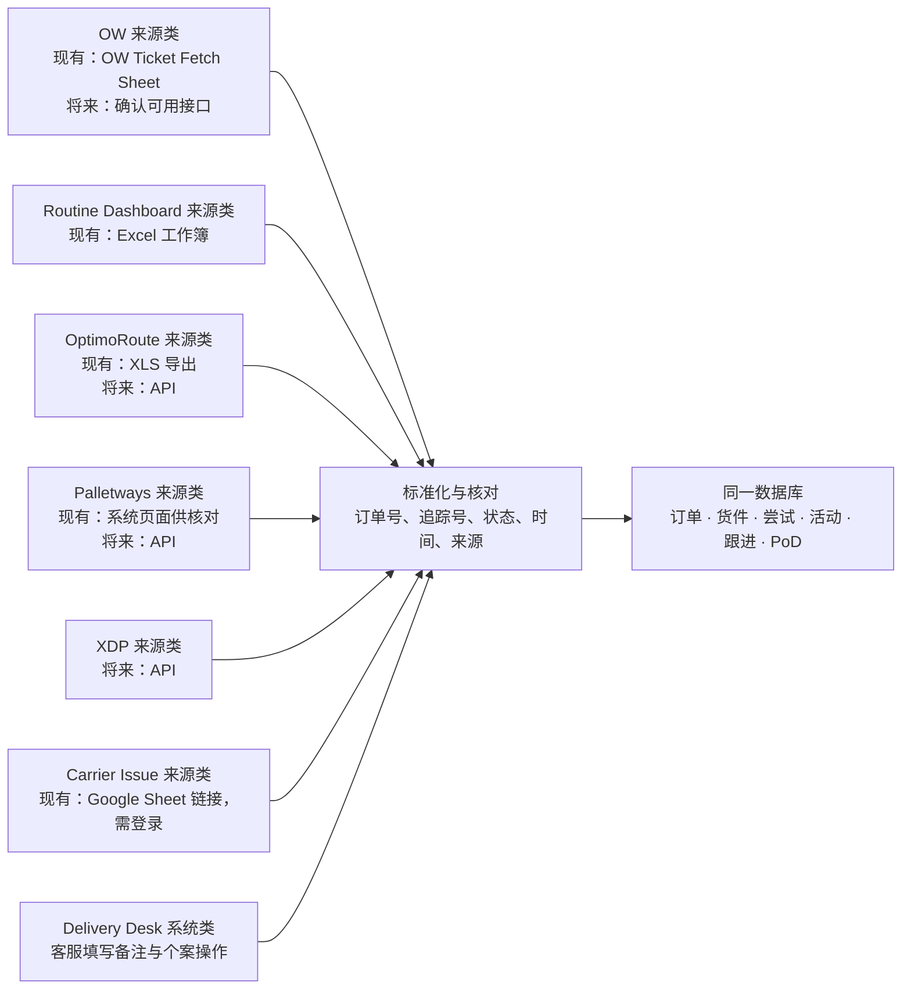
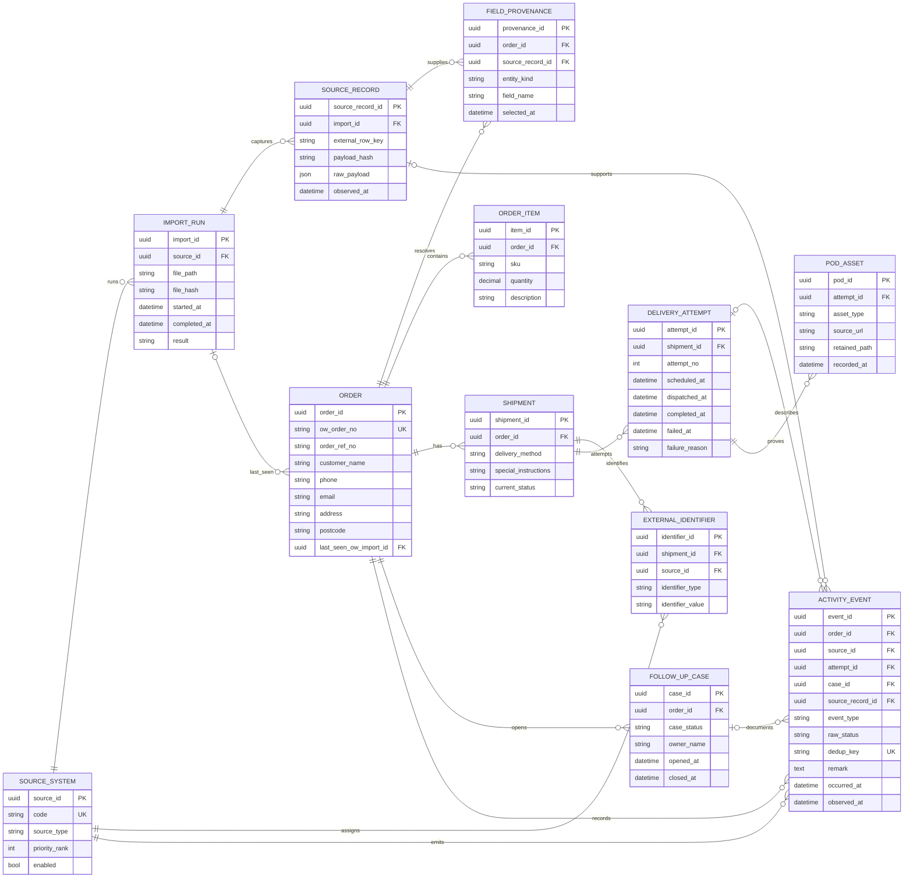

# Delivery Desk 资料来源与数据库设计初稿

先用第一张图认清**每个系统从哪里拿资料、怎样对应**，再用第二张 ERD 看**资料最终怎样保存**。目前只是设计，尚未建立数据库或接入 API。主管确认了重叠资料的更新优先级：**OW 第一、Routine Excel 第二、OptimoRoute 第三**。`Current` 和 `History` 是同一批订单的两种查询视图，不是两张订单表。一个 OW 订单只占一条订单记录；同一订单可以有多次配送尝试，所有状态变化和客服备注持续累积。

## 图一：每个来源各有一个对接类

这里的“类”是**读取和转换资料的模块**，不表示六套互不相通的订单表。每个类只负责自己的文件或 API：读取原始资料、保留来源编号与原文、转换成统一字段；然后由共同的匹配与去重规则写进数据库。将来取得 API 时，可以替换该来源的读取方式，订单、History 和 Activity log 的结构不用跟着重做。

| 来源类 | 目前确定的输入 | 主要输出到统一模型 | 对应同一订单的方法 |
|---|---|---|---|
| **OW 来源类** | `Otherwise` 链接打开为 `OW Ticket Fetch (RAY LIEN)`；正式完整性待确认 | `ORDER` 的订单号、客户和联系资料；`SHIPMENT` 的 delivery method 与特别指示；订单创建或状态观察事件 | `Order no` 作为候选 OW 订单号；该字段的正式唯一性待确认。 |
| **Routine Dashboard 来源类** | `ROUTINE DASHBOARD V2.xlsx` 多个工作表 | 排期／路线线索、运营备注与可能的失败线索；保留工作表名及行号 | `Order ID` 规范化后与 OW `Order no` 精确对照；一格多个编号必须先拆分并人工核对。 |
| **OptimoRoute 来源类** | `OptimoRoute.xls` 导出样本；将来 API | Own van 的 tracking link、配送事件、完成时间、PoD 候选资料 | 核对 `Order ID` 与 OW 编号；`OptimoRoute Order ID` 作为外部编号保存。实际对应关系待样本验证。 |
| **Palletways 来源类** | 现有系统页面截图只用来核对字段；正式同步方式待 API 确认 | Palletways 的 consignment、tracking、扫描事件、PoD | 优先核对 `Customer Ref` 与 OW 订单／参考号；`Consignment Number`、`Tracking ID` 独立保存。实际对应关系待验证。 |
| **XDP 来源类** | 将来 API；目前没有真实字段样本 | XDP tracking、事件、完成时间、PoD（以 API 实际提供为准） | 等 API 样本确认 OW 参考号或其他可验证映射；不能只凭姓名／postcode 合并。 |
| **Carrier Issue 来源类** | `Corrier Issue` Google Sheet 链接，目前要求登录 | 失败个案、跟进状态和备注的候选来源；实际列名待确认 | 优先用 OW 订单号；若只有 tracking／consignment 编号，先通过 `EXTERNAL_IDENTIFIER` 对照，无法确认则留待人工匹配。 |
| **Delivery Desk 系统类** | 客服在本系统新增的跟进备注和个案操作 | `FOLLOW_UP_CASE`、`ACTIVITY_EVENT`；记录作者及时间 | 直接使用当前打开的内部 `order_id`，不再靠姓名匹配。 |

**优先级不是六个系统排成一条队。**OW → Routine → OptimoRoute 只用于三者都有的同一个字段。Palletways 和 XDP 提供各自货件的追踪事实与 PoD；Carrier Issue 提供客服跟进事实。来源的事件和备注都保留，不会因为另一个系统“优先级较高”而删除。

## 图二：统一数据库 ERD

## 资料来源对应

| `SOURCE_SYSTEM.code` | 重叠字段优先级 | 资料形式 |
|---|---:|---|
| `OW_SHEET` | 1 | `ExcelFileLink.docx` 的 `Otherwise` 链接打开为 `OW Ticket Fetch (RAY LIEN)`；已读取列名，是否为正式完整 OW 主数据仍待主管确认 |
| `ROUTINE_EXCEL` | 2 | `ExcelFileLink.docx` 中的 `Routine Dashboard`（主管确认是同一份）；已读取 `ROUTINE DASHBOARD V2.xlsx`，具体同步方式待定 |
| `OPTIMOROUTE` | 3 | Own van 导出／API；本地已有 `.xls` 样本 |
| `PALLETWAYS`、`XDP` | 待定 | 外部承运商资料；不直接套用 Own van 的优先级 |
| `CARRIER_ISSUE` | 不适用 | `CarrierIssueScreenshot.docx` 已显示 Van、Palletways、XDP、Cancelled Orders、Completed Van Deliveries 等页及部分列名；线上链接目前要求登录 |
| `STAFF` | 不适用 | 客服录入的跟进备注和个案操作 |

| 页面资料 / 数据库字段 | 预定来源 | 现有证据与待确认事项 |
|---|---|---|
| 重叠字段的取值优先级 | **1 OW → 2 Routine Excel → 3 OptimoRoute** | 主管已确认此顺序。只有较高优先级来源缺值时才回退到下一来源；各来源原始值都保留在 `SOURCE_RECORD`，选用哪一项记在 `FIELD_PROVENANCE`。 |
| `ow_order_no`, `order_ref_no`, 客户姓名、电话、邮箱、postcode | `OW Ticket Fetch (RAY LIEN)` 的 `Sales Activity` | 已见 `Order no`, `Order reference`, `Delivery name`, `Delivery telephone`, `Delivery email`, `Delivery postcode`。完整地址列暂未见；需确认该 sheet 是否正式主数据。 |
| SKU、数量、特别指示、配送方式 | OW 主订单或相关运营 sheet | `Sales Activity` 已见 `Special instructions`, `Delivery method`，未见正式 SKU／数量列。`Sheet2` 有示例 SKU 行，但不能认定为生产订单明细。 |
| OW sheet 的当前成员资格 | 每次成功读取的最新 OW 表格快照 | 保存 `last_seen_ow_import_id`，不删除旧订单。若订单有未关闭问题，即使退出 sheet 仍留在 Current。若 `OW Ticket Fetch` 只是部分订单筛选结果，不能用它的缺行判定订单已退出 Current。 |
| 排期日期与 Own van 运营备注 | 唯一匹配的 OptimoRoute `Scheduled date` 作为 Own van 排期来源 | 5 笔 OW → Routine → OptimoRoute 一对一样本中，Routine `Date ` 与 OW `Order date` 相同，而 OptimoRoute `Scheduled date` 均为之后的 5 Oct 2026。Routine `Date ` **不得当排期或发货日期**。短参考号 `HG`／`replacement` 会匹配多笔 OptimoRoute 记录，必须排除自动连接。 |
| Own van 追踪链接、车辆／司机 | OptimoRoute，若 OW 或 Routine Excel 也提供则按优先级选值 | `OptimoRoute.xls` 可见 `Tracking Link`, `Driver`, `Vehicle` 等列名。仍需核对与 OW 编号如何连接及 API 是否提供。 |
| PoD 照片、签名、异常 | OptimoRoute 导出或 API | `OptimoRoute.xls` 可见 `Photos`, `Signature`, `PoD - Note`, `Exceptions` 等列名；实际样本值及保留权限待确认。 |
| Palletways tracking ID、consignment number、customer ref、due date、状态、完成日期 | Palletways 系统／API | `PalletwaysScreenshot.docx` 的列表及详情截图显示这些字段，包含 `AT THE HUB`, `DEPARTED HUB`, `AT DELIVERY DEPOT`, `JOB COMPLETE` 样本。API 字段和状态代码仍需实测。 |
| Palletways 扫描事件、备注、PoD | Palletways 系统／API | 截图显示带日期和时间的 Consignment Notes、POD Photo 与扫描图像。需核对 API 权限及文件下载方式。 |
| XDP tracking ID、状态事件、完成时间、PoD | XDP API／导出 | **待确认**：本地 folder 没有 XDP 字段样本或 API 回传。 |
| Failed reason、failed date、follow-up status、每条 follow-up remark | 承运商事件、Courier Issue sheet、客服录入 | 截图显示 Van 的 `Status`、`Date`、`Note`、多列 `Follow up`、`Messaged Status`、`Scheduled Status`；Palletways 的 `Status` 和多列 `Follow up`；XDP 的 `Issue`、`Issues` 和 `Follow up`。需保留每条备注，不把 XDP 货损／遗失自动当作配送失败。 |
| `ACTIVITY_EVENT` 时间线 | OW 导入、承运商事件、客服录入 | 每条记录保存来源、事件发生时间与系统观察时间。没有收到的中间状态不会被自动补造。 |

`ExcelFileLink.docx` 列出 `Otherwise`、`Corrier Issue`、`Routine Dashboard` 三个链接。主管已确认 **Routine Dashboard = Routine Excel**；已从该链接取得只读工作簿并核对列名。`Otherwise` 实际打开为 `OW Ticket Fetch (RAY LIEN)`，与 OW 资料吻合，但尚待确认其数据范围、刷新机制及是否是正式主订单来源。真实 API 回传尚未提供。

## OW 链接实际列名（2026-10-07 样本）

`Sales Activity` 第 1 行可见：`Order no`, `Order date`, `Delivery name`, `eCommerce order number`, `Order reference`, `Special instructions`, `Status`, `Delivery postcode`, `Gross (base)`, `Tracking No`, `Delivery method`, `Customer`, `Delivery telephone`, `Delivery email`, `Despatch Date`, `EbayUserID`, `Order Type`, `Delivery cost`。数据库中只导入配送业务必需字段；金额、平台用户编号先保留在来源原始快照，不默认展示于客服界面。

`Order no` 是候选 OW 订单键；`Order date` 可作为订单创建时间；`Tracking No` 可作为承运商追踪编号的候选映射。`Status` 是 OW 原始代码（样本为 `W`），必须取得代码定义后才能映射成 Unscheduled／Scheduled／Delivered／Failed Delivery。`Delivery method` 样本包含本系统范围以外的承运商，所以导入时必须按 **Van、Palletways、XDP** 筛选，同时保留原始 delivery method 值以便核对。`Sheet2` 只有少量示例 SKU 行，不能据此确定订单商品结构。

**日期核对（2026-10-07 导出）**：OW `Sales Activity` 的 13,294 行订单里，`Despatch Date` 没有一个已填值。与 Routine 以订单号对应后，有 452 个可比较的行组合（同一订单可能出现于多个 Routine 页），其中 437 个 Routine `Date ` 与 OW `Order date` 相同、13 个不同，另 2 个无可比较日期。因此 Routine `Date ` **不能对应成 OW `Despatch Date`**，也不能未经确认用作客户配送日期。

**OptimoRoute 交叉核对**：本地导出含 124 行资料。5 笔一对一匹配的订单，其 Routine `Order Reference` = OptimoRoute `Order ID`，OW `Order date` = Routine `Date `（30 Sep 或 2 Oct），OptimoRoute `Scheduled date` 则为 5 Oct。这个样本支持把前者当订单日期、后者当 Own van 排期日期。仍需确认 OptimoRoute 日期的时区与客户承诺时段含义。

## Routine Excel 实际结构（2026-10-07 样本）

| 工作表 | 已核对的列或内容 | 数据库用途 |
|---|---|---|
| `DASHBOARD` | 第 2 行：`Order ID`, `Customer`, `Postcode`, `Order Reference`, `Status`, `Date `, `Note`, `Delivery`, `Column1`, `Weight`, `Customer Service Comment`, `Paperwork Received`, `Message received between 8am to 12pm` | 订单号、客户和 postcode 可帮助精确匹配；运营状态、日期、配送方式及备注作为低于 OW 的候选值。 |
| `SOUTH 1–6`, `NORTH 1–5`, `LOCAL 1–2`, `West 1`, `WEST 2` | 第 4 行：`Order ID`, `Customer Name`, `Postcode`, `Channel`, `Status`, `Date `, `Note`, `Weight`；页首有路线名与日期 | 记录订单出现在哪个路线页及对应日期；对同一订单重复出现要合并到同一订单，再按可靠证据建立配送尝试。 |
| `Outstanding failed delivery`, `Prolong Failed Deliveries & RTS` | 失败描述、日期、自由文本备注；前者没有稳定表头 | 作为失败线索和人工核对资料，不直接假定每段文字就是一条有准确时间的事件。 |
| `CANCELLED` | 标题和实际列内容有错位（例如标题 `Status` 下出现 postcode） | 不按标题盲导；须单独建立并验证映射。 |
| `NOTES` | 状态代码说明与其他操作注记混排 | 只把已确认的代码映射用于状态解释。 |
| `COLLECTIONS - Outdated`, `Wrap Details`, `SAT OPENING TIMES` | 收货旧表、包装材料、营业时间 | 不纳入当前配送订单主导入。 |

**导入风险**：这是人工维护的多工作表白板，并非规整的一行一单数据。`DASHBOARD` 有分组标题和空行；`Order ID` 有数值、文本及一格多个编号；路线页的 `Status` 也可能是停靠序号，不能与 `DASHBOARD.Status` 同义处理。先按工作表类型分别解析、保留原始单元格与工作表／行号，再做订单号规范化和状态映射。不能仅凭位置、姓名或 postcode 建立订单关联。

## 关键规则

1. **精确连接**：OW 订单号是订单主键。OptimoRoute Order ID、Palletways Customer Ref／Tracking ID、XDP 编号先存入 `EXTERNAL_IDENTIFIER`，只有确认映射后才连到订单；不靠姓名或 postcode 自动合并。
2. **一次失败再重送**：同一 `ORDER` 下保留原配送尝试，再新增下一次 `DELIVERY_ATTEMPT`。列表仍显示一行订单，详情时间线展示所有尝试。
3. **保留历史**：导入更新现有订单并追加不同的 `ACTIVITY_EVENT`；不会因最新 sheet 缺少该订单而删除旧资料。`SOURCE_RECORD` 只保存内容变化的原始版本，避免每轮重复存同一行。
4. **去重与审计**：优先使用来源的事件 ID；没有时用来源、外部编号、事件时间、类型和内容指纹去重。保留原始状态及标准化状态，便于以后修正映射。
5. **资料优先级**：同一字段若多个来源都有非空值，OW 优先于 Routine Excel，Routine Excel 优先于 OptimoRoute。较低优先级的更新仍进入原始记录与 Activity log，但不直接覆盖高优先级的当前显示值。承运商专有字段和 Palletways／XDP 与 OW 的冲突规则需取得真实样本后另定。
6. **Current / History**：仍在最新 OW sheet，或仍有未关闭问题的订单显示于 Current；已退出最新 sheet 且已送达／个案已关闭的订单显示于 History。已完成但仍在最新 sheet 的订单留在 Current。
7. **PoD**：先保存提供方链接及元数据；如果链接会过期且使用条款允许，另存可长期访问的副本。不要把短期签名链接当作永久档案。

## 建表前必须确认

- 确认 `OW Ticket Fetch (RAY LIEN)` 是否为正式且完整的 OW 主数据、其更新方式、状态代码定义，以及 Order No 是否跨所有 sheet 唯一。
- Routine Excel 的下载或本地复制频率、各工作表的正式用途、`Status` 与日期语义，以及自由文本失败记录怎样由业务人员核对。
- OW 编号与 OptimoRoute Order ID、Palletways Customer Ref／Consignment No、XDP 编号的实际对照字段。
- 一个 OW 订单是否可能拆成多个承运商货件，失败重送是否沿用原 tracking ID。
- 三家 API 的真实事件、时间格式、状态代码、PoD 权限和历史保留范围。
