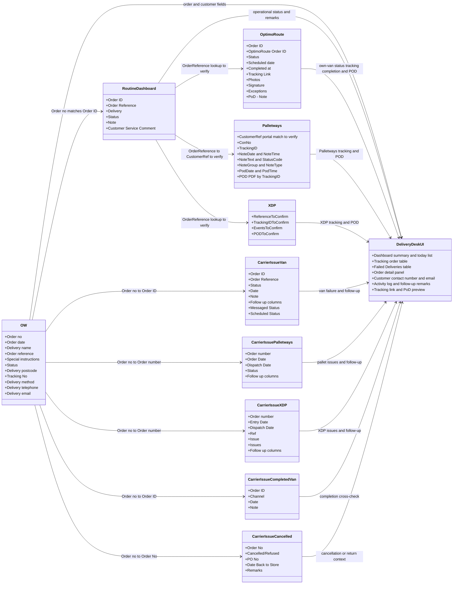

# Delivery Desk: source classes and field mapping

This document follows **one order through the source systems** and identifies the source of each Delivery Desk field. It is a proposed lookup design, not a claim that the joins or APIs have already been verified.

## 1. Class diagram: how source data reaches the Delivery Desk UI

Each source class on the left represents data we may read. **DeliveryDeskUI** on the right represents what staff see in the web app: the Dashboard, Tracking table, Failed Deliveries table, and each order's detail panel. It is a destination in this diagram, **not another data source or a separate database**. The arrows show which source contributes information to the UI; the field-by-field table below defines the exact screen placement and lookup keys.

**Main path:** OW `Order no` → find Routine Dashboard `Order ID` → take Routine `Order Reference` → look up the relevant carrier record → show its verified status, tracking link, completion and PoD. Separately, use OW `Order no` to look up the matching **Van, Palletways or XDP tab** in Carrier Issue for problems and follow-up. Query only the carrier indicated by that shipment's `Delivery method`.

### OW to Carrier Issue: exact key choice

**Use OW `Order no` as the lookup key, not OW `Order reference`.** OW `Order reference` is a secondary cross-check where Carrier Issue supplies a comparable reference.

| Carrier Issue tab | Primary match from OW | Secondary reference check | Evidence / limit |
|---|---|---|---|
| `Van` | OW `Order no` → Carrier Issue `Order ID` | OW `Order reference` ↔ Carrier Issue `Order Reference` | The Van screenshot shows both columns, but the pictured older rows are absent from the inspected current OW export. Verify the pair on a same-order sample. |
| `Palletways` | OW `Order no` → Carrier Issue `Order number` | No separate order-reference column is visible in the screenshot. A consignment number inside `Status` is a different identifier. | Older screenshot rows are absent from the current OW export; exact join awaits a shared sample. |
| `XDP` | OW `Order no` → Carrier Issue `Order number` | **Do not assume** XDP `Ref` = OW `Order reference`; the visible `Ref` values need their meaning confirmed. | Older screenshot rows are absent from the current OW export; exact join awaits a shared sample. |
| `Cancelled Orders` | OW `Order no` → Carrier Issue `Order No` when it is a valid order number | `PO No` is separate; do not equate it to OW `Order reference` without evidence. | Some `Order No` cells contain text such as return labels, so they cannot be auto-matched. |
| `COMPLETED VAN DELIVERIES` | OW `Order no` → Carrier Issue `Order ID` | In two matching screenshot/current-OW examples, its `Channel` value equals OW `Order reference`. | Sample orders `651124` and `651721` confirm both comparisons for those rows only; check more before making `Channel` a general reference rule. |

### OW `Sales Activity`: exact sheet headers and screen meaning

| Exact OW column name | Delivery Desk meaning / use |
|---|---|
| `Order no` | Primary order number shown in lists and used for the first Routine/Carrier Issue lookup. |
| `Order date` | Order creation date; **not** the scheduled delivery date. |
| `Delivery name` | Recipient/customer name shown in Tracking and the detail panel. |
| `Order reference` | OW order reference displayed as Order Ref No. Compare with Routine `Order Reference`; equality is not yet established for every order. |
| `Special instructions` | Delivery instructions displayed in Tracking and detail. |
| `Status` | Raw OW status code; map only after the code definitions are confirmed. |
| `Delivery postcode` | Delivery postcode used for search and display. |
| `Tracking No` | Candidate carrier tracking identifier; verify against the actual carrier record. |
| `Delivery method` | Selects Own van, Palletways or XDP lookup after confirmed label mapping. |
| `Delivery telephone`, `Delivery email` | Customer contact number and email in the Tracking table and order detail panel; contact number is also available for Failed Deliveries follow-up and customer search. |

Do not request or map OW `Gross (base)`, `EbayUserID`, `Order Type`, `Delivery cost`, `Customer` or `eCommerce order number` for the current screens. `Customer` is a sales customer/channel in the inspected rows, not the recipient in `Delivery name`. OW `Despatch Date` is blank throughout the inspected export; leave the screen's dispatch date empty unless another verified source supplies it.

The second join is **the intended workflow described by the team**, but needs real matching-order samples. Routine `Order Reference` can contain short labels such as `HG`; it must **not** be assumed to equal `OptimoRoute.Order ID` for every row. If it does not match, test another explicit reference or a verified OW tracking number. Never join on customer name or postcode alone.

### OptimoRoute: take a field only for a screen use

`DeliveryEvents` was an imprecise label in the earlier diagram. The inspected export shows a **`Status` column**, but does not prove that it contains a full, timestamped event history. A future API may offer events; add them to the activity log only after the actual response has been checked.

| Exact OptimoRoute export column | Why Delivery Desk needs it | Screen location |
|---|---|---|
| `Order ID`, `OptimoRoute Order ID` | Find the own-van record and keep the provider ID distinct from the OW order number. | Matching/cross-check; show the provider reference in detail only when useful. |
| `Status` | Candidate latest own-van status after its values are mapped. A changed status can create a dated observation log entry; it is not proof of every intermediate event. | Tracking status, Dashboard count, detail activity log. |
| `Scheduled date` | Own-van scheduled date/time in the inspected export. Five uniquely matched OW → Routine → OptimoRoute orders have an OptimoRoute scheduled date later than the OW/Routine order date. | Tracking scheduled date, Today's deliveries, detail scheduled date. Confirm timezone and whether this is a customer commitment or internal planned stop time. |
| `Completed at` | Actual completion timestamp when populated and confirmed. | Detail completed date/time, Delivered status, activity log. |
| `Tracking Link` | Open/copy the provider's own tracking page. | Tracking table and detail panel. |
| `Exceptions` | Candidate delivery problem or exception. Do not convert every exception into Failed Delivery. | Failed review and detail activity log when its meaning is verified. |
| `Photos`, `Signature`, `PoD - Note` | Proof assets and accompanying note when supplied for the matched attempt. | Detail PoD viewer and PoD-recorded activity. |

**Do not ingest solely because a column exists:** `Driver`, `Vehicle`, `Weight`, `Volume`, `Latitude`, `Longitude` and other unused export fields are outside the current Customer Service display. `Scheduled at` also remains excluded until its meaning is confirmed. The export has `Start date`, `Start time`, `End date`, `End time`, but their scope has not been established. They are **not** yet mapped to Today's deliveries; use them only after confirming they are an individual customer's delivery window rather than a route-level period.

### Palletways: public tracking milestones versus API data

The [Palletways tracking explanation](https://www.palletways.com/) names four **in-transit milestones**, not a complete list of all possible outcomes: **At collection depot** (collected by the local depot), **At hub** (arrived for sorting), **At delivery depot** (arrived at the destination depot, awaiting loading), and **Out for delivery** (loaded on the delivery vehicle). Delivered, exceptions and failed attempts must be determined from the actual consignment notes/PoD and verified status meanings; they are not implied by the four-milestone list.

The [public API documentation](https://api.palletways.com/documentation/en/index-en.html) describes `getconsignment`, `getnotes` (including a `delta` option for updates since a prior timestamp), and `getPodByTrackingId` (a PoD PDF). Its consignment/note examples include `TrackingID`, `ConNo`, `NoteDate`, `NoteTime`, `NoteText`, `StatusCode`, `NoteGroup`, `NoteType`, `PodDate`, `PodTime` and `PodSignature`. These are documented API fields, **not fields yet observed from our account**. The documentation does not establish that there are exactly four status codes or provide a verified mapping from every `StatusCode` to our UI statuses. Keep each raw code/note and map it only after checking a real account response. The earlier `ScanEvents` label was conceptual, not an API field name, so it has been removed from the class diagram.

### Exact lineage for the fields added to the screen

| Delivery Desk field | Source field seen or expected | Lookup path | Verification needed |
|---|---|---|---|
| **Order Ref No** | OW `Order reference`; Routine `Order Reference` for cross-check | OW `Order no` → Routine `Order ID` | Confirm whether Routine's value is an order reference or a short channel label on each sheet. |
| **Delivery method** | OW `Delivery method` and Routine `DASHBOARD.Delivery` | OW `Order no` → Routine `Order ID` | Normalize equivalent labels (for example, OW `Standard Van Delivery` and Routine `Van`) before comparing. If one says XDP/Palletways and the other says Van or Stopstart, flag it for review rather than choosing silently. |
| **Order date** | OW `Order date` | OW row → same Delivery Desk order | Keep distinct from delivery date. |
| **Dispatch date** | Carrier Issue Palletways/XDP `Dispatch Date`; OW `Despatch Date` only if a future export contains a value | OW order number → matching carrier issue tab | Routine `Date ` is **not** a substitute. Confirm whether each carrier-issue date represents dispatch of the same attempt. |
| **Special instructions** | OW `Special instructions` | OW row → same Delivery Desk order | Routine `Note` is an operational note, not automatically a customer instruction. |
| **Today's scheduled date** | OptimoRoute `Scheduled date` for a uniquely matched own-van order | OW `Order no` → Routine `Order ID` → Routine `Order Reference` → OptimoRoute `Order ID` | Do not use Routine `Date ` as the scheduled date. Confirm the matched carrier order and timezone. |
| **Today's start–end time / detail delivery window** | OptimoRoute export has `Start date`, `Start time`, `End date`, `End time`; a carrier API might provide an order-level window | Same verified own-van lookup | **Do not map these columns directly yet.** First confirm they are for the individual delivery stop rather than the whole driver route. Until then show a separately verified window/ETA, or `TBD`. |
| **Issue note** | Carrier Issue Van `Note`; Palletways `Status` narrative; XDP `Issues` | OW order number → matching carrier issue tab | Preserve raw wording and tab name. |
| **Message status** | Carrier Issue Van `Messaged Status` | OW order number → Van `Order ID` | This is a contact update, not proof of delivery. |
| **Follow-up scheduling** | Carrier Issue Van `Scheduled Status` and dated `Follow up` cells | OW order number → Van `Order ID` | A requested date is not a confirmed booking. |
| **Follow-up remarks** | Each Carrier Issue `Follow up` column; staff-entered remarks | Matched order → tab row → each populated cell | Preserve each note separately with source column and known/observed time. |

## 2. Lookup steps and keys

| Step | Start with | Look for | What is gained | Check before accepting the match |
|---|---|---|---|---|
| **1. OW → Routine** | `OW.Order no` | `Routine DASHBOARD.Order ID` or route-sheet `Order ID` | `DASHBOARD.Delivery` method, route context, notes, customer-service comment, possible failed remark | Normalize number formatting and inspect cells containing multiple IDs. Routine `Date ` usually matches OW `Order date` in the inspected sample; do not use it as dispatch or scheduled delivery date without separate proof. |
| **2. Routine → OptimoRoute (own van)** | `Routine.Order Reference` | `OptimoRoute.Order ID` | Tracking link, current status, `Scheduled date`, completion time, exception, PoD photo/signature | Five one-to-one sample references match and have coherent OW/Routine/Optimo dates. Short repeated references such as `HG` and `replacement` are ambiguous and must not be auto-joined. The export does not prove a full delivery-event history. |
| **3. Routine → Palletways** | `Routine.Order Reference` | `Palletways.Customer Ref` | Consignment/tracking numbers, scans, delivery completion, PoD | **Unverified join.** Confirm reference formatting and whether one reference can have multiple consignments. |
| **4. Routine → XDP** | `Routine.Order Reference` | XDP's OW/customer reference field | XDP tracking and delivery events | **No API sample yet.** Confirm that the reference exists and is unique. |
| **5. OW → Carrier Issue** | `OW.Order no` | `Van.Order ID`, `Palletways.Order number` or `XDP.Order number` according to method | Issue/status text, multiple follow-up notes, message/scheduling updates | The screenshots confirm these column names, but the live sheet and all row formats are not yet available. A cell may contain multiple order numbers; split only with validated rules. |
| **6. Routine → failure clues** | Verified OW order number | Routine failed sheets and free-text notes | Additional failed dates and remarks | Cross-check against Carrier Issue and carrier events; do not turn every free-text note into a precisely timed event. |

### Carrier Issue tabs: what to take from each

| Tab shown in screenshots | Match to OW | Take into Delivery Desk | Important interpretation |
|---|---|---|---|
| **Van** | `Order ID` → OW `Order no`; `Order Reference` helps cross-check | `Status`, `Date`, `Note`, each `Follow up`, `Messaged Status`, `Scheduled Status` | `Status` contains text such as `failed 10/12`, not a clean status code. `Date` may describe the row/operation rather than the exact failure event. Keep the raw wording. |
| **Palletways** | `Order number` → OW `Order no`; any consignment mentioned in `Status` must be verified against Palletways | `Status`, `Order Date`, `Dispatch Date`, each `Follow up` | Status cells contain narrative problems and sometimes a consignment number. Follow-up cells may contain multiple actions in one cell. |
| **XDP** | `Order number` → OW `Order no`; use `Ref` only after its meaning is confirmed | `Entry Date`, `Dispatch Date`, `Issue`, `Issues`, each `Follow up` | Examples include damage, lost items and claims. These are issue records; they are not automatically `Failed Delivery`. |
| **Cancelled Orders** | `Order No` → OW `Order no` when numeric and valid | `Cancelled/Refused`, `Date Back to Store`, `Remarks` | Treat cancellation or return as its own outcome/review flag. Some rows contain text rather than an order number. |
| **COMPLETED VAN DELIVERIES** | `Order ID` → OW `Order no` | Completion evidence from the sheet, once the meaning of its date/status columns is checked | Useful as a cross-check; do not label the row's `Date` as the actual completed timestamp without verification. |

Several tabs repeat the header `Follow up` across adjacent columns. Keep each non-empty cell as a separate note in column order, with its source tab and column. If the text says a date (for example, “booked 4/9”), parse it only after confirming the year; otherwise use the time the note was observed and label it accordingly. Do not overwrite earlier follow-ups with the last populated column.

## 3. Which source fills each part of Delivery Desk?

| Delivery Desk area / field | First source | Additional lookup / comparison | What the user sees |
|---|---|---|---|
| **Dashboard search** | OW order number, customer, phone, postcode | Add verified carrier tracking IDs | A matching order, including retained history. |
| **Dashboard counters** | Normalized status for matched orders | Carrier events and verified failure records refine status | Counts for All, Unscheduled, Scheduled, Delivered and Failed Delivery. |
| **Today's deliveries** | OptimoRoute `Scheduled date` for uniquely matched own-van orders; equivalent verified carrier schedule for Palletways/XDP | A verified **order-level** start/end window adds exact times; otherwise use a verified ETA | Order number, customer, start–end time when both are known, method, or `TBD`. OW `Order date` and Routine `Date ` are not the scheduled delivery date. |
| **Tracking: Order No / Order Ref No** | OW `Order no` / `Order reference` | Routine IDs locate operational records | One row per OW order. |
| **Tracking: customer, contact, postcode, instructions** | OW `Delivery name`, `Delivery telephone`, `Delivery email`, `Delivery postcode`, `Special instructions` | Routine customer/postcode as fallback or mismatch check | Customer name, contact number and email together; postcode and instructions in their columns. |
| **Tracking: delivery method** | OW `Delivery method` | Compare Routine `DASHBOARD.Delivery` and the actual carrier record. Routine is a useful operational cross-check/fallback if OW is blank or not a usable carrier label. | Own van, Palletways or XDP tab/filter; flag unresolved conflicts. Exclude unsupported providers such as Stopstart from this tracking scope. |
| **Tracking: scheduled date** | Own van: uniquely matched OptimoRoute `Scheduled date`; other carriers: confirmed equivalent schedule | Do not use OW `Order date`, OW `Despatch Date`, or Routine `Date ` as a fallback | Date or `—` when no trustworthy date exists. |
| **Tracking: latest status / tracking no** | Matched carrier events and tracking ID | Compare OW and Routine raw statuses; confirm code meanings | Unscheduled, Scheduled, Delivered or Failed Delivery; tracking link when available. |
| **Failed Deliveries table** | Verified failure from carrier event, Routine failed record or Carrier Issue `Van.Status`/carrier-specific status text | Carrier Issue adds dated issue text and follow-up columns; confirm each date's meaning | Failed date/reason, contact and follow-up status for the same order. An XDP damage/loss claim alone is not proof of a failed delivery. |
| **Detail panel: order and customer** | OW | Routine for route/operational context | Full customer details, references, instructions and scheduled date. |
| **Detail panel: tracking and completion** | The actual carrier: OptimoRoute, Palletways or XDP | OW/Routine locate and cross-check it | Tracking link, completed date/time and carrier facts actually supplied. |
| **Detail panel: activity log** | OW order date; Routine operational facts; carrier events | Each populated Carrier Issue `Follow up` cell and staff remark becomes a separate sourced entry. Keep sheet name, column and observed time when the note has no explicit timestamp. | Numbered sequence through attempts, failure, rescheduling, delivery and PoD; only observed steps appear. |
| **Detail panel: PoD** | The carrier that completed that attempt | Check link expiry and permissions | View/copy PoD link and image preview when available. |
| **Current / History** | Confirmed current OW feed membership | Open failed case and completed carrier outcome | Both views searchable; do not use missing OW rows as closure until feed completeness is confirmed. |

## 4. Comparison rules

1. **Same field in OW, Routine and OptimoRoute:** use the supervisor's precedence **OW → Routine Dashboard → OptimoRoute** when values have the same meaning and are valid. Keep the other values for mismatch checks.
   For `Delivery method`, normalize OW service labels to the three supported provider groups first. Routine `Delivery` can verify or fill a missing/indeterminate OW value, but it must not silently override a conflicting valid OW carrier.
2. **Carrier-specific facts:** the actual carrier supplies tracking, scan events, completion and PoD. OW/Routine locate the shipment; they do not replace carrier event history.
3. **Failure and follow-up:** carrier failure events, Routine failure notes, Carrier Issue entries and staff remarks remain separate dated facts. Do not collapse several remarks into one.
4. **Status mapping:** retain every raw status. Convert to the four UI statuses only after the source meanings are known. A Routine route-sheet stop number is not a delivery status.
5. **Missing or conflicting key:** leave the carrier record unmatched and flag it for review. A plausible name/postcode match is insufficient to attach PoD or failure to an order.

## Evidence and open checks

- **Seen:** OW Ticket Fetch `Sales Activity` headers; Routine Dashboard workbook headers and mixed-format rows; OptimoRoute export headers; Palletways screen fields.
- **Date cross-check:** The inspected OW export has **13,294 order rows and zero populated `Despatch Date` cells**. Of 452 comparable OW-to-Routine row matches (some orders occur on more than one Routine sheet), Routine `Date ` equals OW `Order date` in 437 and differs in 13; two lack a comparable date. This strongly suggests Routine `Date ` is often the order date, but the remaining differences and business definition still need confirmation. It is **not** evidence for a dispatch-date mapping.
- **OptimoRoute date cross-check:** The local `.xls` export has 124 data rows. There are five **one-to-one** matches where Routine `Order Reference` equals OptimoRoute `Order ID`. In all five, OW `Order date` = Routine `Date ` (30 Sep or 2 Oct 2026), while OptimoRoute `Scheduled date` = **5 Oct 2026**. This directly distinguishes the order date from the own-van scheduled date in those samples. Broad references `HG` and `replacement` produce many-to-many matches and are excluded from this proof.
- **Delivery-method cross-check:** Routine `DASHBOARD` has an explicit `Delivery` column. Among 140 matched OW/Routine dashboard rows, common pairs include `Van` ↔ OW `Standard Van Delivery` (67), `Van` ↔ `Self Delivery BQ` (15), and `Van` ↔ `Next Day Van Delivery` (14). It also contains Stopstart, XDP, Palletways, blanks and `tbc`; some pairs conflict. Both fields therefore belong in the source mapping, with normalization and conflict review.
- **Seen in `CarrierIssueScreenshot.docx`:** `Van` has `Order ID`, `Customer`, `Postcode`, `Order Reference`, `Status`, `Date`, `Note`, several `Follow up` columns, `Messaged Status` and `Scheduled Status`. `Palletways` has `Date`, `Order number`, `Order Date`, `Dispatch Date`, `Status` and several `Follow up` columns. `XDP` has `Entry Date`, `Order number`, `Dispatch Date`, `Ref`, `Issue`, `Issues` and `Follow up` columns. There are also `Cancelled Orders` and `COMPLETED VAN DELIVERIES` tabs. The screenshots show fields, not a verified API or complete live-sheet extract.
- **Not yet seen:** a confirmed same-order OW → Routine → OptimoRoute/Palletways/XDP example; real carrier API payloads; full Carrier Issue sheet data (the link requires sign-in here).
- **Before implementation:** obtain real matching orders for each carrier and verify the exact join key, status meanings, event timestamps and PoD access.

## Sheet-by-sheet verification status

**Verified** means the actual header row was read from an accessible workbook or is visible in the supplied screenshot. It does **not** mean the field's business meaning or cross-system join has been proven.

| Source | Sheet(s) | Header status | Delivery Desk use / gap |
|---|---|---|---|
| OW Ticket Fetch | `Sales Activity` | **Verified:** actual header row read | Candidate master order/contact/method fields. Completeness and status-code meanings remain unverified. |
| OW Ticket Fetch | `Sheet2` | **No formal header:** only two visible sample SKU rows | Do not use as production item data without confirmation. |
| Routine Dashboard | `DASHBOARD` | **Verified:** row 2 headers read | Candidate order ID, reference, date, status and notes; mixed headings/rows need parsing. |
| Routine Dashboard | `SOUTH 1–6`, `NORTH 1–5`, `LOCAL 1–2`, `West 1`, `WEST 2` | **Verified:** common row 4 headers read | Route/date context. Route `Status` can be a stop number, so semantics remain unverified. |
| Routine Dashboard | `Outstanding failed delivery`, `Prolong Failed Deliveries & RTS` | **No stable header** in inspected rows | Failed-delivery clues only; dates and remarks need row-level interpretation. |
| Routine Dashboard | `CANCELLED` | **Header seen but misaligned with data** | Needs its own checked mapping before import. |
| Routine Dashboard | `NOTES` | **Mixed reference notes**, not a normal order table | Use only confirmed code definitions. |
| Routine Dashboard | `COLLECTIONS - Outdated`, `Wrap Details`, `SAT OPENING TIMES` | **Headers seen** | Outside the current Van/Palletways/XDP delivery tracking scope. |
| Carrier Issue | `Van`, `Palletways`, `XDP` | **Partly verified:** visible screenshot columns, not full sheets | Key fields and follow-up columns mapped above; unseen columns and row variations remain open. |
| Carrier Issue | `Cancelled Orders`, `COMPLETED VAN DELIVERIES` | **Partly verified:** visible screenshot columns | Cancellation/return and van completion checks; exact completion-date semantics remain open. |
| Carrier Issue | `XDP monthly damage report`, `Yodel`, `STOPSTART`, `Ship2Man` | **Sheet names only:** headers not supplied | XDP damage report may matter but needs a screenshot/export. The other three are outside the confirmed provider scope unless business rules say otherwise. |
| OptimoRoute | Local `.xls` export | **Header names visible**, sample row values/API schema not verified | Start/end date-time scope and OW/Routine reference join are still open. |
| Palletways | Portal screenshots | **Screen fields visible**, API schema not verified | Customer Ref/consignment/tracking mapping and event codes need real API samples. |
| XDP | API/export | **Not supplied** | Tracking, events, PoD and matching reference remain open. |
